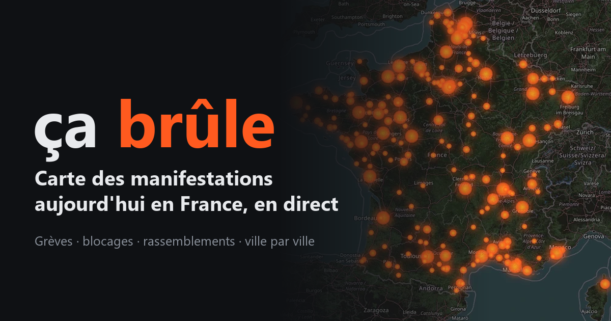

# ça brûle — carte des manifestations en France

Carte en direct des manifestations, grèves, blocages et rassemblements en France, construite à partir des titres de la presse en ligne.
Démo : **https://oraclemarin.fr/cabrule/**



## Ce que ça fait

- Lit en continu des flux de presse (RSS) et des agrégateurs d'actualités, garde les titres qui parlent de mobilisation, repère la commune citée et place un point sur la carte. Chaque point renvoie à l'article source.
- Mise à jour toutes les 10 minutes. Recherche d'une ville, zoom qui interroge la presse du secteur, filtres par thème (lycéens, agriculteurs, travail, transports, santé, écologie…).
- Deux cartes complémentaires, issues de recensements associatifs publics : féminicides conjugaux ([collectif Féminicides par compagnons ou ex](https://www.feminicides.fr/)) et décès liés à la police ([Désarmons-les](https://desarmons.net/)). Noms retirés, positions ramenées au centre de la commune.
- Pages rendues côté serveur pour le référencement : une page par ville active, pages des deux cartes, page « sources et méthode », `sitemap.xml`, `llms.txt`.

## Comment c'est fait

- **Un seul fichier Python, aucune dépendance** : uniquement la bibliothèque standard (`http.server`, `urllib`, `xml.etree`…). Le front est une page HTML avec [Leaflet](https://leafletjs.com/) (inclus dans `static/lib`).
- **Géocodage** : la commune est détectée dans le titre à l'aide de la base officielle des communes ([geo.api.gouv.fr](https://geo.api.gouv.fr/)), téléchargée au premier lancement.
- **Cascade de sources** : flux RSS directs, Google Actualités, Bing Actualités, GDELT, Mastodon. Quand une source limite les requêtes (HTTP 429/503), un disjoncteur la met en pause et les autres prennent le relais ; pour la recherche d'une commune, dernier recours sur les articles déjà collectés.
- **Charge allégée** : l'API n'envoie pas les liens d'articles (56 % du poids) ; un clic passe par une redirection courte `/go/<id>`. Passage de 323 Ko à 39 Ko compressés.
- **Persistance** : les articles des dernières 24 h sont sauvegardés dans `store.json` pour survivre à un redémarrage.

## Lancer en local

```bash
python app.py            # http://localhost:8765
PORT=8780 python app.py  # autre port
```

Variables d'environnement : `PORT` (défaut 8765), `BASE_URL` et `BASE_PATH` (adresse publique et préfixe d'URL, pour les liens canoniques, le sitemap et les pages ville ; par défaut `https://oraclemarin.fr/cabrule` et `/cabrule`).

La première collecte prend 1 à 2 minutes. Évitez de redémarrer en boucle : chaque démarrage complet envoie une centaine de requêtes aux sources et peut vous faire limiter.

## Limites

- Carte **indicative** : elle ne montre que ce que la presse relaie, avec des erreurs de localisation possibles. Une mention dans un titre n'est pas une confirmation.
- Ce n'est pas un décompte officiel du nombre de manifestants ni d'incidents.
- Seuls le titre, la source, la date et le lien sont conservés ; les contenus des articles restent la propriété de leurs éditeurs.

## Licence et crédits

Licence : à choisir par l'auteur (MIT, AGPL…) avant publication.
Fond de carte © contributeurs [OpenStreetMap](https://www.openstreetmap.org/copyright). Leaflet : licence BSD-2-Clause.

Édité par Quentin Closset — [Oracle Marin](https://oraclemarin.fr/) · [À propos](https://oraclemarin.fr/apropos/)
